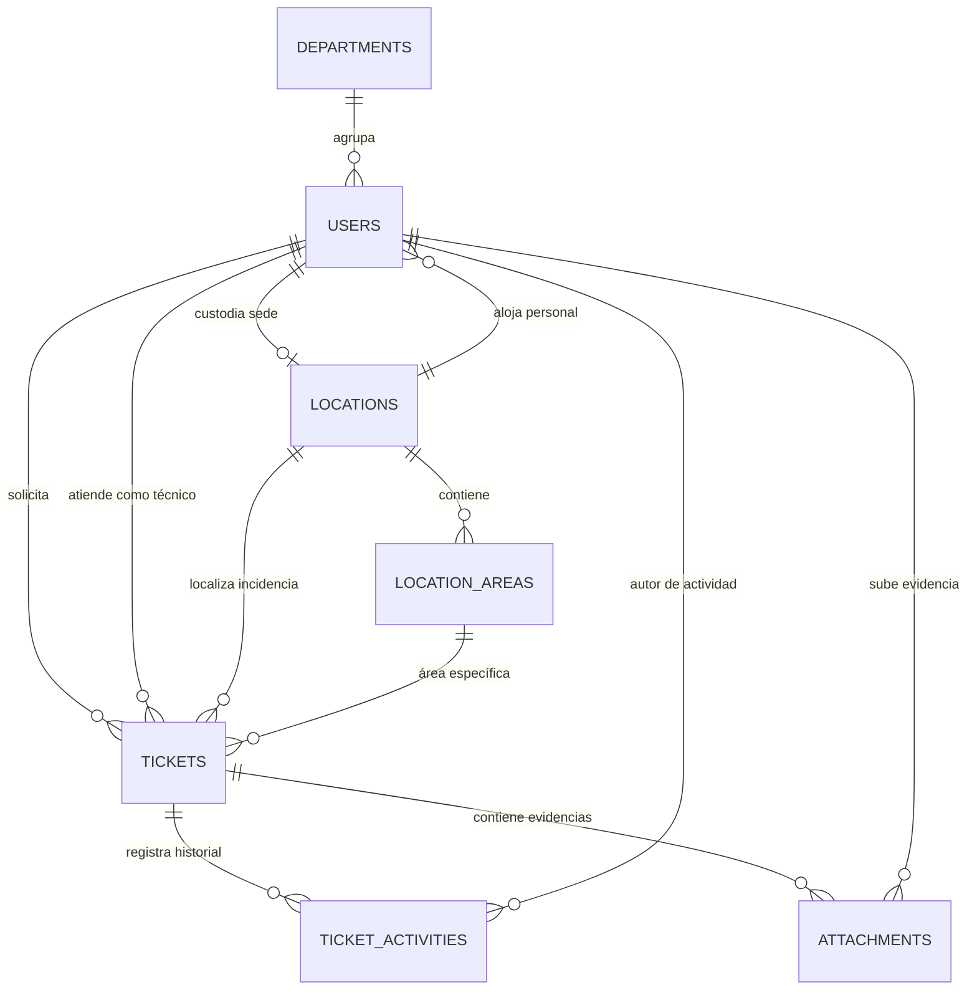

# TICKETAPP - SISTEMA INTEGRAL DE GESTIÓN DE SOLICITUDES DE SERVICIOS
**Documentación de Especificación de Requerimientos, Arquitectura, Base de Datos y Casos de Uso (Versión Actualizada)**

---

## 1. Identificación y Descripción General del Proyecto

- **Nombre del Sistema:** TicketApp  
- **Propósito:** Sistema web empresarial para el registro, asignación, seguimiento, resolución y trazabilidad de solicitudes de servicios e incidencias operativas.  
- **Alcance Operativo:** Centraliza la interacción entre solicitantes (colaboradores y personal institucional), técnicos de soporte, directores de departamento y administradores de sistemas, reemplazando flujos informales por un proceso estandarizado con acuerdos de nivel de servicio (SLA) medibles, auditoría cronológica y evidencias multimedia.

---

## 2. Tipos de Usuarios y Matriz de Roles (RBAC)

El sistema opera bajo un esquema estricto de **Control de Acceso Basado en Roles (RBAC)** aplicado bidireccionalmente: en el frontend mediante guardas de enrutamiento y bloqueo visual de controles, y en el backend mediante políticas y validación de claims JWT en cada comando/consulta CQRS.

### 2.1 Definición y Alcance de Roles

| Rol | Clave de Sistema | Permisos, Alcance y Restricciones Operativas |
| :--- | :--- | :--- |
| **Solicitante** | `requestor` | **Solo lectura y creación de sus propias solicitudes:** • Puede crear solicitudes vinculándose automáticamente como solicitante. • Puede anexar evidencias iniciales únicamente durante la creación. • **Aislamiento de visualización:** Solo visualiza sus propias solicitudes (`RequesterId == currentUserId`). • **Inmutabilidad post-creación:** Una vez creado el ticket, no puede modificar título, descripción, prioridad, categoría ni sede. • **Restricciones de flujo:** No puede asignar/cambiar técnicos, no puede alterar el estado operativo (bloqueado en vista tabular y drag-and-drop deshabilitado en Kanban), no puede subir ni eliminar evidencias posteriores, y no tiene acceso a notas técnicas privadas. Puede registrar notas públicas para comunicación con el técnico. |
| **Técnico** | `technician` | **Gestión operativa y resolución de solicitudes:** • Acceso a su bandeja de tickets asignados (`/tickets/assigned`) y tickets generales. • Diagnostica incidencias, actualiza estados operativos (`in_progress`, `on_hold`). • Registra notas internas de diagnóstico técnico y respuestas públicas dirigidas al solicitante. • Anexa nuevas evidencias de respaldo técnico y elimina evidencias obsoletas con modal de confirmación. • Ejecuta la resolución y cierre técnico del ticket (`resolved`), registrando de forma obligatoria el resumen de solución aplicada. |
| **Director** | `director` | **Supervisión ejecutiva y control departamental:** • Visibilidad global de todas las solicitudes y sedes de la institución. • Consulta tableros de control, reportes y métricas de cumplimiento de SLA. • Supervisa la carga operativa de los técnicos, custodios de sedes y áreas físicas. • Puede reasignar solicitudes entre especialistas de soporte si la operación lo demanda. |
| **Administrador** | `admin` | **Control total y gobierno del sistema:** • Gestión integral del catálogo de usuarios (altas, bajas, asignación de fotos de avatar institucional y roles). • Configuración de sedes, áreas/bloques físicos, custodios y capacidades. • Asignación, reasignación y anulación de cualquier ticket. • Gestión completa de evidencias (subida y eliminación) y parametrización operativa. |

### 2.2 Matriz de Operaciones por Rol

| Acción / Funcionalidad | Solicitante (`requestor`) | Técnico (`technician`) | Director (`director`) | Administrador (`admin`) |
| :--- | :---: | :---: | :---: | :---: |
| Crear nueva solicitud | ✅ | ✅ | ✅ | ✅ |
| Visualizar tickets ajenos | ❌ | ✅ | ✅ | ✅ |
| Modificar datos básicos post-creación | ❌ | ❌ | ⚠️ (Reasignar) | ✅ |
| Asignar / Cambiar técnico responsable | ❌ | ❌ | ✅ | ✅ |
| Transicionar estado (diagnóstico / espera) | ❌ | ✅ | ✅ | ✅ |
| Mover tarjetas en tablero Kanban (Drag & Drop) | ❌ (Bloqueado) | ✅ | ✅ | ✅ |
| Resolver ticket con justificación técnica | ❌ | ✅ | ✅ | ✅ |
| Subir evidencias durante creación | ✅ | ✅ | ✅ | ✅ |
| Subir evidencias posteriores al expediente | ❌ | ✅ | ✅ | ✅ |
| Eliminar evidencias (con modal seguro) | ❌ | ✅ (Autor/Asignado) | ✅ | ✅ |
| Previsualizar evidencias multimedia / PDF en modal | ✅ (Sus tickets) | ✅ | ✅ | ✅ |
| Descargar evidencias físicas vía Blob | ✅ (Sus tickets) | ✅ | ✅ | ✅ |
| Publicar respuestas públicas en el timeline | ✅ | ✅ | ✅ | ✅ |
| Registrar notas técnicas privadas internas | ❌ | ✅ | ✅ | ✅ |
| Gestión de Usuarios y Roles | ❌ | ❌ | ❌ | ✅ |
| Gestión de Sedes y Áreas Físicas | ❌ | ❌ | ⚠️ (Solo lectura) | ✅ |

---

## 3. Estados Operativos del Ticket y Gestión de SLA

### 3.1 Ciclo de Vida de una Solicitud
1. **Pendiente (`pending` - 1):** Ticket registrado en cola de triaje, a la espera de validación o asignación de especialista.
2. **En Proceso (`in_progress` - 2):** Técnico asignado trabajando activamente en la solución técnica o diagnóstico.
3. **En Espera (`on_hold` - 3):** Solicitud pausada temporalmente por espera de repuestos, contratistas externos o validación del solicitante.
4. **Resuelto (`resolved` - 4):** Cierre técnico completado; requiere obligatoriamente el ingreso de `ResolutionSummary` y concluye el cómputo de SLA.
5. **Cancelado (`cancelled` - 5):** Solicitud anulada por duplicidad, error de origen o desistimiento formal.

### 3.2 Motor de Cálculo de SLA (Acuerdos de Nivel de Servicio)
- **Normalización UTC:** El sistema calcula la fecha de vencimiento (`slaDueAt`) proyectada a partir de la prioridad establecida (Baja, Media, Alta, Crítica).
- **Indicador Donut y Temporizador:**
  - Para tickets activos: calcula el tiempo restante y porcentaje transcurrido, clasificando visualmente en *En Plazo Óptimo* (verde), *Por Vencer* (amarillo/naranja, < 1 hora restante o > 80% consumido) o *Vencido* (rojo).
  - Para tickets concluidos (`resolved` o `cancelled`): detiene la cuenta regresiva y presenta el badge finalizador **"Completado"** o **"Cancelado"**.

---

## 4. Funcionalidades Principales del Sistema

1. **Autenticación y Sesión Segura:** Login con JWT Bearer Token, almacenamiento seguro, interceptores HTTP, auto-logout ante token expirado (401) y restauración de sesión en recarga.
2. **Mesa de Ayuda y Dashboard Operativo:** Métricas en tiempo real de volumen de incidencias (totales, en proceso, pendientes, resueltas, fuera de SLA), accesos rápidos y lista de actividad reciente.
3. **Creación Asistida de Solicitudes:**
   - Selección dinámica en cascada de Sede y Área Física correspondiente.
   - Categorización jerárquica con cálculo automático de SLA según prioridad.
   - Anexado simultáneo de múltiples evidencias durante el registro inicial.
   - Bloqueo y vinculación automática al perfil del solicitante autenticado.
4. **Visualización Dual (Tabla y Tablero Kanban):**
   - **Vista Tabular:** Paginación, ordenamiento multinivel, filtros combinados (texto, prioridad, estado, sede, rango de fechas) y selectores de asignación directa para roles autorizados.
   - **Vista Kanban:** Columnas por estado operativo. Para técnicos y administradores permite drag-and-drop ágil y menús contextuales rápidos; para solicitantes el tablero se bloquea en modo solo lectura para garantizar la integridad del flujo.
5. **Expediente Centralizado de la Solicitud (Ticket Detail):**
   - Stepper visual del estado de avance.
   - Ficha de solicitante, sede, área física y técnico asignado con estado de presencia en vivo (`online`, `busy`, `offline`).
   - Bitácora cronológica unificada (`TicketActivities`) con diferenciación visual de eventos automáticos, respuestas públicas y notas técnicas privadas.
6. **Centro de Gestión Multimedia de Evidencias:**
   - **Compatibilidad multiformato:** Imágenes (JPG, PNG, WebP, GIF), documentos (PDF, Word, Excel, texto plano), archivos comprimidos (ZIP, RAR) y elementos multimedia (video MP4, audio).
   - **Modal de Previsualización Integrado (`FilePreviewModal`):** Permite inspeccionar imágenes en alta resolución, reproducir videos HTML5 y previsualizar PDFs completos mediante *Object URLs* (`URL.createObjectURL(blob)`) generados en memoria, evitando bloqueos por *Mixed Content* (HTTP/HTTPS).
   - **Descarga Física Segura:** Botón de descarga con fallback nativo a streams de datos Blob que fuerza la descarga física al almacenamiento del usuario sin abrir pestañas inseguras.
   - **Eliminación Segura con Diálogo Nativo:** Eliminación controlada de evidencias obsoletas mediante comando backend (`DeleteTicketAttachmentCommand`) con eliminación física en disco, registro automático en la bitácora de auditoría y confirmación estética en frontend mediante componente modal `Dialog` (sin alertas genéricas del navegador).
7. **Gestión Administrativa de Sedes e Infraestructura:**
   - Mantenimiento de campus, sucursales y áreas/bloques técnicos.
   - Control de custodios responsables en sitio, capacidades de aforo y notas de acceso físico.
8. **Gestión de Directorio de Usuarios y Colaboradores:**
   - Registro de personal con código de empleado, cargo, departamento, teléfono y fotografía institucional (avatar).
   - Administración granular de roles de sistema.

---

## 5. Diseño Físico de la Base de Datos (PostgreSQL en Supabase)

El sistema utiliza **PostgreSQL** alojado en la nube a través de **Supabase**, gestionado mediante **Entity Framework Core** (`Npgsql.EntityFrameworkCore.PostgreSQL`). Todas las marcas de tiempo se almacenan en `TIMESTAMPTZ` con precisión UTC y las claves foráneas mantienen integridad referencial estricta.

### 5.1 Tabla: `Users`
Almacena las cuentas institucionales, credenciales y colaboradores del sistema.

| Campo | Tipo de Dato | Nulo | Descripción |
| :--- | :--- | :--- | :--- |
| `Id` | SERIAL / INTEGER PRIMARY KEY | No | Identificador único del usuario |
| `EmployeeCode` | VARCHAR(50) | No | Código institucional de empleado (ej. `EMP-001`) |
| `Name` | VARCHAR(150) | No | Nombre y apellidos del usuario |
| `Email` | VARCHAR(150) | No | Correo electrónico institucional (Índice único) |
| `PasswordHash` | TEXT | No | Hash criptográfico de la contraseña (BCrypt / PBKDF2) |
| `Role` | INTEGER | No | Rol del sistema (1: Solicitante, 2: Técnico, 3: Admin, 4: Director) |
| `Position` | VARCHAR(100) | No | Cargo o puesto de trabajo |
| `Phone` | VARCHAR(30) | No | Teléfono de contacto directo |
| `Extension` | VARCHAR(10) | Sí | Extensión telefónica interna |
| `AvatarUrl` | VARCHAR(500) | Sí | Ruta relativa del avatar (ej. `/uploads/avatars/...`) |
| `Presence` | INTEGER | No | Disponibilidad (1: Online, 2: Busy, 3: Offline) |
| `LocationId` | INTEGER (FK) | Sí | Referencia a la sede asignada (`Locations.Id`) |
| `DepartmentId`| INTEGER (FK) | Sí | Referencia al departamento funcional (`Departments.Id`) |
| `IsActive` | BOOLEAN | No | Estado de la cuenta (true: Activo, false: Inactivo) |
| `CreatedAt` | TIMESTAMPTZ | No | Fecha y hora UTC de registro |

### 5.2 Tabla: `Locations`
Almacena las sedes, sucursales, campus o edificios de la institución.

| Campo | Tipo de Dato | Nulo | Descripción |
| :--- | :--- | :--- | :--- |
| `Id` | SERIAL / INTEGER PRIMARY KEY | No | Identificador único de la sede |
| `Code` | VARCHAR(50) | No | Código corporativo de la sede (ej. `SED-001`) |
| `Name` | VARCHAR(150) | No | Nombre descriptivo del campus o sede |
| `FacilityType` | VARCHAR(100) | No | Clasificación (ej. `Campus Principal`, `Sucursal`) |
| `Address` | VARCHAR(250) | No | Dirección física completa |
| `City` | VARCHAR(100) | No | Ciudad |
| `PostalCode` | VARCHAR(20) | Sí | Código postal |
| `Phone` | VARCHAR(30) | No | Teléfono de contacto de la sede |
| `IpGuardExtension` | VARCHAR(20) | Sí | Extensión IP de caseta de seguridad |
| `SecurityNotes` | VARCHAR(500) | Sí | Protocolos o notas especiales de acceso físico |
| `EstimatedStaffCapacity` | VARCHAR(50) | Sí | Capacidad de personal estimada |
| `AvailableFloors` | VARCHAR(50) | Sí | Cantidad o desglose de niveles disponibles |
| `CustodianId` | INTEGER (FK) | Sí | Referencia al custodio de sede (`Users.Id`) |
| `IsActive` | BOOLEAN | No | Estado operativo de la sede |

### 5.3 Tabla: `LocationAreas`
Define los pisos, salas técnicas, bloques o áreas específicas pertenecientes a una sede.

| Campo | Tipo de Dato | Nulo | Descripción |
| :--- | :--- | :--- | :--- |
| `Id` | SERIAL / INTEGER PRIMARY KEY | No | Identificador del área física |
| `LocationId` | INTEGER (FK) | No | Referencia a la sede padre (`Locations.Id`) |
| `Name` | VARCHAR(100) | No | Nombre del área (ej. `Laboratorio A`, `Piso 3`) |
| `FloorOrBlock` | VARCHAR(50) | Sí | Identificador de bloque, nivel o edificio |
| `IsActive` | BOOLEAN | No | Estado operativo del área |

### 5.4 Tabla: `Departments`
Estructura organizativa institucional para clasificación de colaboradores.

| Campo | Tipo de Dato | Nulo | Descripción |
| :--- | :--- | :--- | :--- |
| `Id` | SERIAL / INTEGER PRIMARY KEY | No | Identificador del departamento |
| `Code` | VARCHAR(50) | No | Código interno (ej. `DEP-TI`, `DEP-ADM`) |
| `Name` | VARCHAR(150) | No | Nombre del departamento institucional |
| `IsActive` | BOOLEAN | No | Estado operativo |

### 5.5 Tabla: `Tickets`
Entidad principal que almacena el ciclo de vida de las solicitudes de servicio.

| Campo | Tipo de Dato | Nulo | Descripción |
| :--- | :--- | :--- | :--- |
| `Id` | SERIAL / INTEGER PRIMARY KEY | No | Identificador numérico único del ticket |
| `Sequence` | INTEGER | No | Correlativo secuencial numérico |
| `Code` | VARCHAR(50) | No | Código público formateado (ej. `#TK-1001`) |
| `Title` | VARCHAR(200) | No | Asunto o título sintético de la solicitud |
| `Description` | TEXT | No | Descripción detallada de la problemática |
| `Category` | VARCHAR(100) | No | Categoría principal (ej. `TI & Redes`, `Infraestructura`) |
| `Subcategory` | VARCHAR(100) | Sí | Subcategoría específica de atención |
| `Priority` | INTEGER | No | Prioridad (1: Baja, 2: Media, 3: Alta, 4: Crítica) |
| `Status` | INTEGER | No | Estado (1: Pendiente, 2: En Proceso, 3: En Espera, 4: Resuelto, 5: Cancelado) |
| `LocationId` | INTEGER (FK) | No | Referencia a la sede donde ocurre (`Locations.Id`) |
| `LocationAreaId` | INTEGER (FK) | Sí | Referencia al área física puntual (`LocationAreas.Id`) |
| `RequesterId` | INTEGER (FK) | No | Colaborador solicitante (`Users.Id`) |
| `AssigneeId` | INTEGER (FK) | Sí | Especialista técnico asignado (`Users.Id`) |
| `CreatedAt` | TIMESTAMPTZ | No | Fecha y hora UTC de creación |
| `UpdatedAt` | TIMESTAMPTZ | No | Fecha y hora UTC de la última actualización |
| `SlaDueAt` | TIMESTAMPTZ | No | Fecha y hora límite UTC según SLA acordado |
| `ResolvedAt` | TIMESTAMPTZ | Sí | Fecha y hora UTC de resolución técnica |
| `ResolutionSummary` | TEXT | Sí | Detalle o justificación de la solución aplicada |

### 5.6 Tabla: `TicketActivities`
Bitácora de auditoría, trazabilidad de eventos y registro de notas internas/públicas.

| Campo | Tipo de Dato | Nulo | Descripción |
| :--- | :--- | :--- | :--- |
| `Id` | SERIAL / INTEGER PRIMARY KEY | No | Identificador del evento de actividad |
| `TicketId` | INTEGER (FK) | No | Referencia al ticket vinculado (`Tickets.Id`) |
| `AuthorId` | INTEGER (FK) | No | Autor del evento o comentario (`Users.Id`) |
| `ActivityType` | INTEGER | No | Tipo (1: Creación, 2: Cambio Estado, 3: Asignación, 4: Nota, 5: Respuesta Pública, 6: Escalación, 7: Adjunto, 8: Eliminación Adjunto) |
| `Message` | TEXT | No | Contenido del comentario o detalle de auditoría |
| `IsPublic` | BOOLEAN | No | true si es visible al solicitante, false para nota técnica privada |
| `PreviousValue` | VARCHAR(250) | Sí | Valor anterior (ej. estado o técnico previo) |
| `NewValue` | VARCHAR(250) | Sí | Nuevo valor establecido |
| `CreatedAt` | TIMESTAMPTZ | No | Marca de tiempo UTC del evento |

### 5.7 Tabla: `Attachments`
Registro de documentos, imágenes y evidencias adjuntas al expediente del ticket.

| Campo | Tipo de Dato | Nulo | Descripción |
| :--- | :--- | :--- | :--- |
| `Id` | SERIAL / INTEGER PRIMARY KEY | No | Identificador del archivo |
| `TicketId` | INTEGER (FK) | No | Referencia al ticket padre (`Tickets.Id`) |
| `UploadedById` | INTEGER (FK) | No | Usuario que anexa la evidencia (`Users.Id`) |
| `FileName` | VARCHAR(255) | No | Nombre original del archivo |
| `FileUrl` | VARCHAR(500) | No | Ruta relativa normalizada `/uploads/evidences/{guid}_{filename}.ext` |
| `PhysicalPath` | VARCHAR(500) | No | Ruta física del archivo en el sistema de almacenamiento |
| `FileSize` | BIGINT | No | Tamaño del archivo en bytes |
| `MimeType` | VARCHAR(100) | No | Tipo MIME del contenido (ej. `application/pdf`, `image/png`) |
| `UploadedAt` | TIMESTAMPTZ | No | Fecha y hora UTC de carga |

> [!NOTE]
> Las rutas en `FileUrl` y `AvatarUrl` se persisten en base de datos de manera relativa (`/uploads/...`). El cliente frontend y el backend resuelven la URL absoluta de forma dinámica respetando el esquema seguro (`https://`) a través de encabezados proxy (`X-Forwarded-Proto`, `X-Forwarded-Host`), garantizando interoperabilidad entre entornos locales y despliegues en la nube.

---

## 6. Diagrama Entidad-Relación (ERD Conceptual)

---

## 7. Catálogo de Casos de Uso del Sistema

| Código | Caso de Uso | Actores Participantes | Descripción |
| :--- | :--- | :--- | :--- |
| **CU-01** | Iniciar Sesión y Autenticación | Todos los usuarios | Valida credenciales, emite JWT Bearer y recupera rol y perfil de permisos. |
| **CU-02** | Registro de Nueva Solicitud | Solicitante, Técnico, Admin, Director | Captura la incidencia vinculando sede, área y evidencias iniciales con cálculo de SLA. |
| **CU-03** | Consulta y Filtrado de Solicitudes | Todos (acceso restringido para Solicitante) | Visualización tabular o Kanban. El solicitante solo visualiza sus tickets y con controles de cambio deshabilitados. |
| **CU-04** | Consulta de Tickets Asignados | Técnico, Admin, Director | Bandeja de trabajo focalizada del técnico para atender las solicitudes bajo su responsabilidad. |
| **CU-05** | Asignación / Reasignación de Técnico | Administrador, Director | Asigna un técnico evaluando disponibilidad en vivo (`Presence`) y balance de carga. |
| **CU-06** | Transición de Estado y Diagnóstico | Técnico, Administrador | Cambia el estado del ticket (`in_progress`, `on_hold`) registrando auditoría en tiempo real. |
| **CU-07** | Resolución y Cierre de Solicitud | Técnico, Administrador | Registra la justificación técnica (`ResolutionSummary`), concluye el SLA y marca el ticket como `resolved`. |
| **CU-08** | Registro de Notas y Trazabilidad | Técnico, Administrador, Solicitante | Publica notas técnicas internas privadas o respuestas públicas en el timeline. |
| **CU-09** | Gestión Multimedia de Evidencias | Técnico, Administrador, Director (Solicitante en creación) | Anexa archivos, visualiza en modal con Blob URLs (sin Mixed Content), descarga forzada y eliminación con diálogo nativo. |
| **CU-10** | Administración de Usuarios y Perfiles | Administrador | Gestiona el directorio de personal, actualización de avatares y configuración de roles. |
| **CU-11** | Administración de Sedes y Áreas | Administrador, Director | Mantenimiento de campus, asignación de custodios, áreas físicas y aforos. |

---

## 8. Arquitectura Tecnológica y Despliegue en la Nube

El sistema está concebido bajo una arquitectura desacoplada y escalable, preparada para entornos productivos en la nube:

### 8.1 Backend (.NET 10 Web API - Clean Architecture)
- **TicketApp.Core / Domain:** Entidades de dominio, agregados, enumeraciones (`DomainEnums.cs`) e interfaces de contratos base.
- **TicketApp.Application:** Patrón CQRS con **MediatR**, validaciones centralizadas con **FluentValidation** y DTOs estructurados.
- **TicketApp.Infrastructure:** 
  - **Acceso a Datos:** **Entity Framework Core** configurado para **PostgreSQL** mediante `Npgsql.EntityFrameworkCore.PostgreSQL`.
  - **Base de Datos Gestionada:** Alojada en **Supabase** con `Pooling` y conexión transaccional protegida con SSL.
  - **Almacenamiento de Archivos:** `LocalFileStorageService` para persistencia en disco de evidencias y avatares con rutas relativas normalizadas.
- **TicketApp.API:** 
  - Controladores RESTful con versionado (`/api/v1`).
  - Autenticación JWT Bearer con validación de roles en endpoints.
  - Soporte de proxies inversos mediante `UseForwardedHeaders` (`X-Forwarded-Proto`, `X-Forwarded-Host`) para emisión segura de URLs HTTPS.
  - Middleware de excepciones global y políticas de CORS optimizadas.
- **Despliegue Backend:** Contenedor Docker desplegado en la plataforma **Render** con soporte HTTPS automático.

### 8.2 Frontend (React 19 + TypeScript + Vite + Tailwind CSS v4)
- **Gestión de Estado:** **Zustand** stores (`useTicketStore`, `useUserStore`, `useSiteStore`) con políticas de sincronización seguras para prevenir colisiones de datos.
- **Enrutamiento y Guardas:** **React Router v7** con `ProtectedRoute` que restringe rutas según roles permitidos (`allowedRoles`).
- **Diseño de Interfaz:** **Tailwind CSS v4** y componentes accesibles (Radix / Base-UI) para ventanas modales (`Dialog`), tooltips y menús contextuales.
- **Manejo de Evidencias y Seguridad:**
  - `FilePreviewModal`: Previsualización interactiva con `URL.createObjectURL(blob)` para evitar advertencias de *Mixed Content* al consultar la API remota.
  - Descarga robusta vía streams Blob.
  - Eliminación con modal in-app de confirmación.
- **Despliegue Frontend:** Alojado en **Vercel** con integración continua (CI/CD) vinculada al repositorio del proyecto.
